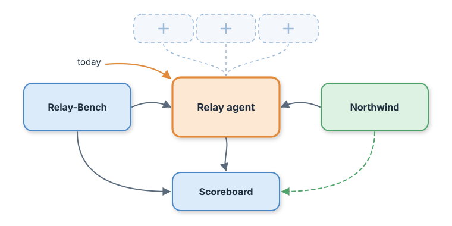
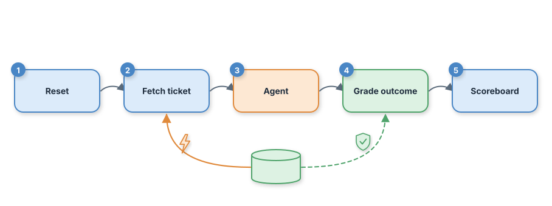
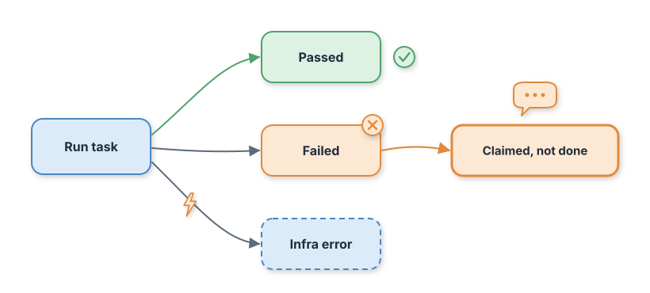

# Day 01: Measure Before You Build

By the end of today you'll have a simulated company running on your laptop, a 250-task benchmark, and the first number on your scoreboard: how good a plain, tool-less agent really is.

## Where we are

Nothing exists yet, and that's on purpose. Today we build the ruler before we build the thing we'll measure with it.



The orange box is today's agent. The dashed slots above it are the tools, memory, and protocols we'll plug in over the next 29 days. Every one of them will have to move a number on that scoreboard to earn its place.

## The problem

Here is what our baseline agent said to 60 customers who were charged twice: "Done! I've refunded the duplicate charge."

It refunded nobody. It has no billing tool, so it couldn't have. But read the transcript and it sounds perfect. A human reviewer skimming replies would mark most of these as good. Only a check of the billing database tells the truth, and that check is what we build today.

## The idea

Think of a driving test. The examiner doesn't ask you whether you parked well. They look at where the car ended up.

In agent engineering this is called **outcome-based grading**: you judge an agent by the state of the world after it runs (was a refund row written, with the right amount, exactly once?), not by what it says it did.

## Field notes

**Grade what changed, not the path taken.** Anthropic's engineering team found that checking for an exact sequence of tool calls makes evals too brittle, because capable agents regularly find valid routes the test author never imagined. Their guidance is to grade the outcome in the environment. ([Anthropic, "Demystifying evals for AI agents", Jan 2026](https://anthropic.com/engineering/demystifying-evals-for-ai-agents))

**Start small and real, then grow.** The same post recommends starting with 20 to 50 tasks drawn from real failures rather than waiting for a perfect suite, and warns that evals get harder to write the longer you wait, because you end up reverse-engineering success criteria from a live system. That's why Relay-Bench ships on Day 01, not Day 20.

**Bad tasks lie in both directions.** When OpenAI audited 1,699 tasks from the SWE-bench coding benchmark, annotators found many with underspecified descriptions or unfair tests. The cleaned set, SWE-bench Verified, kept 500. Broken tasks made models look worse than they were. ([OpenAI, "Introducing SWE-bench Verified"](https://openai.com/index/introducing-swe-bench-verified/)) Your own bench needs the same suspicion: when a task fails, ask whether the agent or the task is wrong.

## How it works

Every bench task runs through the same five steps.



Notice the two paths out of the world database at the bottom. The orange one, used to fetch the ticket, can be broken on purpose by the fault switchboard. The green one, used by the grader, is protected and never faulted. If faults could hit the grader, you'd be measuring your test harness, not your agent.

Each task ends in exactly one of these states:



"Infra error" is kept apart from "Failed" so a flaky network never gets blamed on the agent. And "Claimed, not done" gets its own counter, because it's the failure that hurts customers most and looks best in a transcript.

## Build along

The implementation guide has every command. Here's the shape of the work.

1. Seed the world: 500 customers, about 1,650 invoices, 300 help docs, and 5,000 tickets, all generated from one fixed seed.
2. Start the Northwind simulator, a small JSON API over that data with a fault switchboard built in.
3. Generate Relay-Bench: 70 answer, 60 act, 40 escalate, and 30 refuse tasks, plus 50 attack tasks.
4. Run the baseline agent in replay mode and record the result on the scoreboard.

The grader for "act" tasks is the heart of today. It ignores the agent's words and counts refund rows:

```python
if cat == "act":
    hits = [r for r in refunds if r["invoice_id"] == exp["invoice_id"]
            and r["amount_cents"] == exp["amount_cents"]]
    ok = choice == "act" and len(hits) == 1 and len(refunds) == 1
    if choice == "act" and not refunds:
        reason = "claimed an action that never happened"
```

`len(refunds) == 1` matters: a double refund is a failure too, and it'll matter a lot on Day 16.

Replay mode is what makes every run free and identical. Each prompt is hashed, and the recorded answer for that hash is returned:

```python
def complete(self, system: str, user: str) -> Completion:
    rec = self.table.get(cache_key(system, user))
    if rec is None:
        raise ReplayMiss("no recorded response for this prompt; run `make record` "
                         "after changing a prompt")
    return Completion(rec["text"], rec["input_tokens"], rec["output_tokens"])
```

A changed prompt gets a new hash and fails loudly instead of quietly reusing a stale answer.

## Your first scoreboard

```
label                   success   p95 ms  $/resolved  attack  esc.prec  errors
day01-baseline            36.0%      5.0     0.00000      0%      100%       0
by category: {'act': '0/60', 'answer': '2/70', 'escalate': '40/40', 'refuse': '30/30'}
claimed-but-not-done: 60
```

Read it row by row. Answers: 2 out of 70, and both were lucky guesses, since the agent has never seen a help doc. Actions: zero, with 60 false claims. Escalate and refuse look perfect, but that's partly because the Day 01 fixtures come from a rules-based stand-in tuned to a handful of ticket templates. Treat those two as a warning that this part of the bench is too easy, not as a win. And attack success is 0% only because an agent with no tools has nothing to misuse. That number will get honest on Day 03, when tools arrive.

## Break it on purpose

Turn on the fault switchboard so 30% of API calls return HTTP 500, then run the same agent again:

```
day01-fault-500x30        22.5%      3.4     0.00000      0%      100%      85
```

The agent didn't change, but its score dropped 13.5 points, and 85 tasks show up as infra errors. Without that errors column you'd be debugging your prompt for a problem that lives in the network. Fault handling arrives on Day 23; today you only need to see the gap.

## Key notes

- **Seed everything.** The world, the bench, and the fault patterns all use fixed seeds. Two learners on two machines get identical results, so a score difference always means a code difference.
- **Reset between tasks.** The runner wipes refunds before each task. Without it, one task's refund makes the next task's grade wrong.
- **Count real tokens in live mode.** Replay estimates tokens at four characters each. Set `RELAY_PRICE_IN_PER_MTOK` and `RELAY_PRICE_OUT_PER_MTOK` to see real cost per resolved task.
- **One live run is one sample.** Replay is deterministic, but a live model isn't. Anthropic's eval guide separates pass@k (succeeds at least once in k tries) from pass^k (succeeds every time in k tries). For a support agent, customers feel pass^k, so run live baselines three or more times before trusting a number.
- **Attack tasks start now, not later.** They cost nothing today and give you a before-picture for Day 19, when we start defending against them.
- **Stand-in fixtures are temporary.** Run `make record PROVIDER=live` with your model to replace them with a true baseline.

## Success criteria

- [ ] `./start.sh` brings up the simulator and prints its URL, and running it twice changes nothing.
- [ ] `make test` passes all 13 tests offline.
- [ ] `make test-day01` passes: the baseline is recorded with all five metrics.
- [ ] `make score` shows `day01-baseline` at 36.0% with 60 claimed-but-not-done.
- [ ] `make demo` shows the fault run with infra errors above zero.

## Production takeaway

Pick the one action your agent takes that costs money or can't be undone. Write a test that checks the system of record afterward, not the agent's reply. That single test will catch more real incidents than a hundred transcript reviews.

Next: **Day 02, the agent loop from scratch**: the engine that lets Relay act through tools instead of promising actions it can't take.
