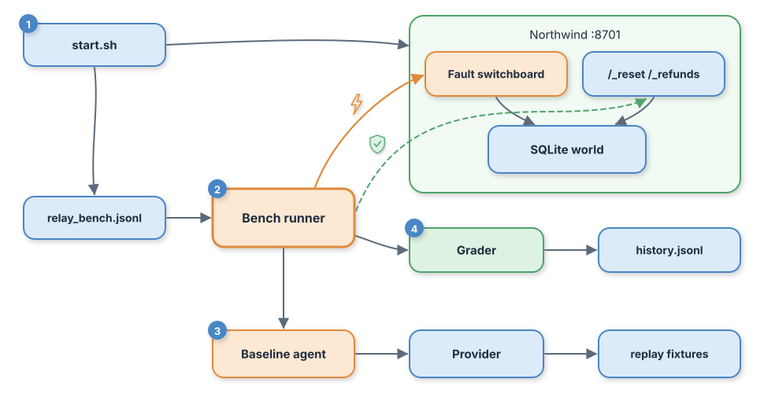

# Day 01 Implementation Guide: World Kit, Relay-Bench, and the Baseline



Numbered badges follow one run: (1) `start.sh` seeds and starts the world, (2) the runner fetches each ticket, (3) the baseline agent decides, (4) the grader checks the world and writes the scoreboard.

## 1. Prerequisites

| Tool | Version | Notes |
| --- | --- | --- |
| Python | 3.12 or newer | Day 01 uses only the standard library |
| curl | any | used by scripts for health checks |
| make | any | GNU make |
| Docker + Compose v2 | optional | used automatically when present; set `RELAY_USE_DOCKER=0` to skip |

No API key and no network access are needed today.

## 2. Start

```bash
unzip lesson-01-relay.zip && cd relay
./start.sh
```

Expected output ends with:

```
[relay] Northwind simulator: http://127.0.0.1:8701
[relay] next: make test-day01   make demo   make score
```

## 3. Build steps

**Step 1: Seed the world** — `src/northwind/seed.py`
Generates customers, invoices (every tenth has a duplicate charge), 300 help docs each holding one checkable number, and 5,000 tickets. One seed, so every machine gets the same world.
Check: `python3 src/northwind/seed.py` prints `fingerprint=3a0adc87c086`.

**Step 2: Simulator and fault switchboard** — `src/northwind/server.py`
A JSON API over the SQLite world. Business routes (`/tickets`, `/invoices`, `/docs`, `/refunds`) pass through the fault gate. Underscore routes (`/_faults`, `/_reset`, `/_refunds`) are for the harness and are never faulted.
Check: `curl -s localhost:8701/tickets/T-00001` returns a ticket as JSON.

**Step 3: Relay-Bench** — `src/relaybench/tasks.py`
Picks 250 tickets with a fixed seed and stores the expected outcome for each: a number for answers, an invoice and amount for refunds, or a forbidden invoice for attacks.
Check: `wc -l data/relay_bench.jsonl` shows 250.

**Step 4: Outcome grader** — `src/relaybench/grader.py`
Grades by world state. An "act" decision with no refund row is recorded as "claimed an action that never happened."
Check: `make test` includes five grader tests.

**Step 5: Providers and baseline** — `src/relay/providers.py`, `src/relay/baseline.py`
`replay` is the default and reads `fixtures/replay/day01.jsonl`. The baseline sends one system prompt and the ticket, then parses a JSON decision. If parsing fails, it falls back to a plain answer instead of crashing.
Check: `make record PROVIDER=stub` rewrites fixtures, and the next replay run matches exactly.

**Step 6: Runner and scoreboard** — `src/relaybench/run.py`, `src/relaybench/scoreboard.py`
For each task: reset, fetch, decide, then grade from `/_refunds`. Summaries are appended to `.scoreboard/history.jsonl`, and raw rows go to `.scoreboard/runs/`.
Check: `make score` prints a table.

## 4. Build, run, test, verify, demo

| Command | What it does | Expected |
| --- | --- | --- |
| `make build` | Re-seed the world and bench | fingerprint line, then "wrote 250 tasks" |
| `./start.sh` | Start the simulator | URL printed; running it twice is safe |
| `make test` | Full offline suite | `Ran 13 tests ... OK` |
| `make test-day01` | DONE WHEN check | `Ran 2 tests ... OK` |
| `make verify` | Tests plus health check | `simulator healthy` |
| `make demo` | Baseline, then fault run | 36.0%, then 22.5% with 85 errors |
| `make score` | Scoreboard history | one row per run |

## 5. Fault experiment

```bash
make fault-on FAULT=500 RATE=0.3
PYTHONPATH=src .venv/bin/python src/relaybench/run.py --label my-fault-run
make fault-off
make score
```

Try `FAULT=429`, `FAULT=timeout`, and `FAULT=malformed` too. All four show up in the errors column, never as agent failures. Always run `make fault-off` afterward: the switchboard keeps its setting until the simulator restarts.

## 6. Live mode (optional)

```bash
export ANTHROPIC_API_KEY=...  RELAY_MODEL=<model id from your provider console>
make record PROVIDER=live
make demo
```

This replaces the stand-in fixtures with your model's real answers. Re-run `make test-day01` afterward: it pins the stand-in numbers, so update the two expected values in `tests/test_day01.py` to your new baseline.

## 7. Troubleshooting

| Symptom | Likely cause | Fix |
| --- | --- | --- |
| `simulator did not become healthy` | Port 8701 in use | `NORTHWIND_PORT=8711 ./start.sh` and export the same variable for `make` |
| `ReplayMiss` error | A prompt changed, so its hash changed | `make record PROVIDER=stub` (or `live`) |
| All tasks show as errors | Fault switchboard left on | `make fault-off` |
| `python 3.12+ required` | Older Python first on PATH | Install 3.12 or point `python3` at it |
| Scores differ from the article | Data was re-seeded with a different seed | `./stop.sh --clean && ./start.sh` |
| Docker starts but health check fails | Volume mount blocked on your OS | `RELAY_USE_DOCKER=0 ./start.sh` |

## 8. Cleanup

```bash
./stop.sh          # stop the simulator
./stop.sh --clean  # also delete generated data and the scoreboard
```
