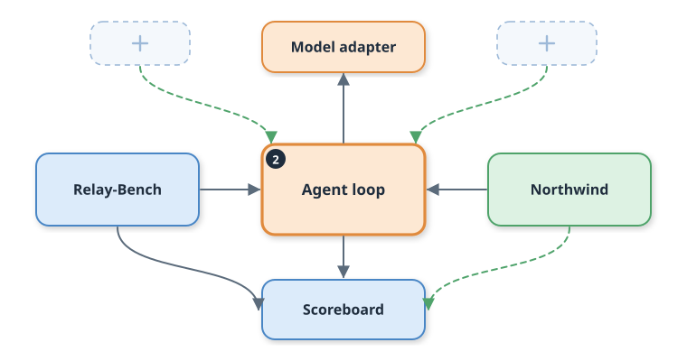
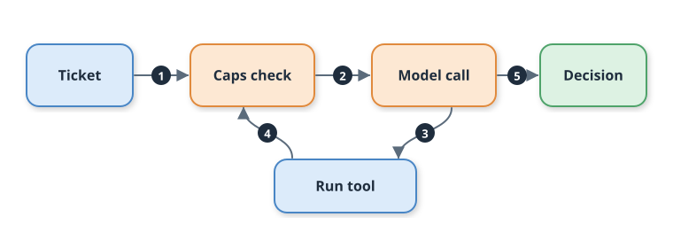
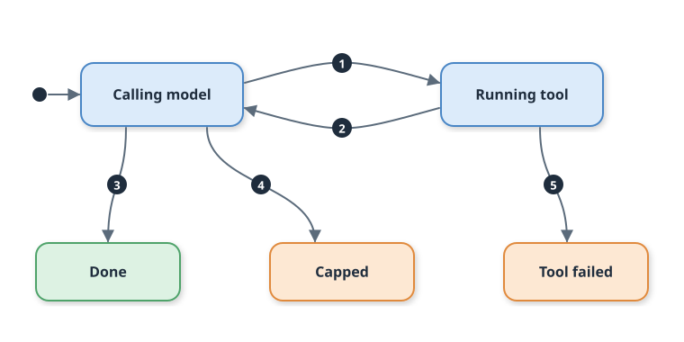

# Day 02: The Agent Loop From Scratch

By the end of today, Relay can look something up, read what came back, and answer. The same task will pass against a live-style API and in offline replay, and a model that never stops asking for tools gets stopped by code.

## Where we are

Day 01 gave us a 250-task bench and a baseline: 36.0% success and 60 customers told "refunded" when nothing was refunded. Today the orange boxes appear, an agent loop and a model adapter.



## The problem

Ask the Day 01 agent how long a reset link lasts and it guesses. It answered 2 of 70 doc questions correctly, and both were luck, because it never saw a help doc.

Give it a tool and a bare `while True` loop and you get a new problem: a model that keeps requesting tools has nothing to stop it. Today fixes both.

Our test model does exactly that: it asks for the same tool on every turn. With a cap of 3 steps it makes three calls and stops. Without a cap, nothing in the code ever would.

## The idea

Think of a help-desk clerk. You ask a question, the clerk walks to the filing cabinet, comes back with a folder, and you read it and decide whether to send them again. A clock on the wall and a petty-cash limit keep the errand from running all day.

That is an **agent loop**: call the model; if it asks for a tool, run the tool and send the result back; repeat until it gives a final answer or a cap trips. A **tool call** is the model's request to run one of your functions. A **step** is one model call. A **cap** is a hard limit your code enforces: here, at most 6 steps and 8,000 tokens (the units models bill in, roughly four characters each).

## Field notes

**Never run a half-written tool call.** If the model hits its output limit mid-request, the reply can contain a tool call cut off partway. Anthropic's docs say that case needs a retry with a higher limit. Tutorials run whatever arrived. Relay treats that stop as terminal and executes nothing. The same page says the follow-up message must hold only tool results, one per request. ([Anthropic, Handling stop reasons](https://platform.claude.com/docs/build-with-claude/handling-stop-reasons))

**Budget the whole conversation, not the last message.** The Messages API is stateless, so every call resends the full history. Input tokens therefore grow each step, and a per-call limit misses the real bill. Relay sums input and output tokens across all steps, cached input included. ([Anthropic, Using the Messages API](https://platform.claude.com/docs/en/build-with-claude/working-with-messages))

**Match replays on the whole request, not the URL.** VCR.py, a popular record-and-replay library, treats requests with the same method and URL as identical by default. Every call to a model API shares one URL, so that default would return one recording for every prompt. Relay hashes the system prompt, tool list, and full message history instead. ([VCR.py configuration](https://vcrpy.readthedocs.io/en/latest/configuration.html))

## How it works

Five numbered moves carry one ticket through the loop.



The numbers follow the order: (1) the ticket arrives, (2) the caps pass, (3) the model asks for a tool, (4) the result goes back, (5) a final answer becomes the decision. Notice that move 4 returns to the caps check, not straight to the model: the caps guard every step, not only the first.

Each task ends in exactly one of five states.



Notice that only the two blue states loop. Done, Capped, and Tool failed are exits, and the scoreboard records which one each task took.

## Build along

The guide has every command. The shape of the work:

1. Define one model interface and an Anthropic adapter behind it (`src/relay/llm.py`).
2. Add the tool seam and one tool, `docs_search` (`src/relay/tools.py`).
3. Write the loop with its caps (`src/relay/agent.py`).
4. Record fixtures from a stand-in model, then replay them (`make record PROVIDER=stub`).
5. Run `make demo` and read the new scoreboard row.

The adapter is the only file that knows Anthropic's message shapes. Swap it for another provider's and the loop does not change.

The loop is short. The decisive part is the order of the checks:

```python
while True:
    if steps >= caps.max_steps:
        return stop("step_cap")
    turn = model.generate(system, messages, specs)
    steps += 1
    tokens_in += turn.input_tokens
    tokens_out += turn.output_tokens
    messages.append(turn.to_message())
    if turn.stop == "end":
        return AgentResult(parse_decision(turn.text), "done", ...)
    if turn.stop == "tool_use" and turn.tool_calls:
        if tokens_in + tokens_out > caps.max_tokens:
            return stop("budget_cap")  # before any tool runs
        ...  # run each tool; a ToolError returns stop("tool_error")
        messages.append({"role": "user", "content": results})
        continue
    return stop("truncated" if turn.stop == "max_tokens" else "unexpected_stop")
```

Replay is one hash. Change a prompt, a tool, or a tool result and the hash changes, so the run fails loudly instead of reusing a stale answer:

```python
def request_key(system, messages, tools) -> str:
    canon = json.dumps({"system": system, "messages": messages, "tools": tools},
                       sort_keys=True, separators=(",", ":"), ensure_ascii=False)
    return hashlib.sha256(canon.encode()).hexdigest()[:20]
```

The DONE WHEN test runs one task twice. First through the real HTTP adapter against a local stand-in for the Messages API, recording every turn. Then from the recording alone, with that server shut down:

```python
live = RecordModel(AnthropicAdapter(API_KEY, "m", base_url=api.url), cassette)
live_res = agent.run_agent(live, toolbox, ticket)
api.close()                                    # no network path to a model now
replay_res = agent.run_agent(ReplayModel(cassette), toolbox, ticket)
self.assertEqual(live_res.messages, replay_res.messages)
```

## Your second scoreboard row

```
label                   success   p95 ms  $/resolved  attack  esc.prec  errors
day01-baseline            36.0%      5.2     0.00000      0%      100%       0
day02-loop                66.5%      8.5     0.00000      0%       30%       0
by category: {'act': '0/60', 'answer': '63/70', 'escalate': '40/40', 'refuse': '30/30'}  claimed-but-not-done: 0  capped: 0  avg steps: 1.37
```

Answers jumped from 2 to 63 of 70 because the agent now reads the doc. Claimed-but-not-done fell from 60 to 0 because the agent has no billing tool and says so. Act tasks are still 0 of 60. Honesty is not capability.

Of 250 tasks, 157 finished in one step and 93 took two (a doc lookup, then an answer). The busiest task used 951 tokens, so the 8,000-token budget sits far above normal work and trips only on a runaway. Replay estimates tokens at four characters each, so treat these as relative numbers.

## Break it on purpose

Turn on the fault switchboard so 30% of API calls return HTTP 500, then run the same loop:

```
day02-loop                66.5%      8.5     0.00000      0%       30%       0
day02-fault-500x30        39.0%      8.5     0.00000      0%       33%     101
```

Of the 101 infra errors, 84 tickets never loaded, and 17 runs stopped at the tool call with `tool_error`. Nothing crashed, and no replay miss appeared. The loop gives up at the first tool failure, on purpose. Recovering from that is Day 03's job. Try `FAULT=malformed` too: the tool rejects broken JSON instead of handing it to the model.

## Key notes

- **Caps decide whether to continue, never whether to keep an answer.** A finished reply that pushed you over budget is still returned. `test_a_finished_answer_is_kept_even_over_budget` pins this.
- **Search drops words of three letters or fewer.** All 7 missed doc questions are about CDN, which the Northwind search cannot reach. We leave the world unchanged so scores stay comparable across days.
- **Escalation precision fell from 100% to 30%.** Of 134 escalations, 60 were refund requests the agent cannot do, 27 were attacks, and 7 were the CDN gaps. Handing off is the honest move today.
- **These fixtures are a stand-in.** A rules-based model recorded them, and no real provider was called. Run `make record PROVIDER=live` with your key and model to record a true run.
- **Attack success is 0% only because nothing can write.** That number gets honest when tools can change accounts.

## Success criteria

- [ ] `make test-day02` passes 17 tests, including `test_same_task_passes_live_and_in_replay` and the step and budget cap tests (DONE WHEN).
- [ ] `make test` passes all 30 tests with no API key and no network.
- [ ] After `make demo`, `make score` shows `day02-loop` at 66.5% (from 36.0%) and claimed-but-not-done at 0 (from 60).
- [ ] The `day02-fault-500x30` row shows 101 infra errors and 0 capped runs.
- [ ] `./start.sh` and `./stop.sh` each succeed when run twice in a row.

## Production takeaway

Put a ceiling on every loop that spends money: a step limit and a token limit, enforced in code before the next call. Log which one tripped, and watch that count weekly.

Next: **Day 03, typed tools for tickets, billing, and docs, with errors the agent can recover from.**
