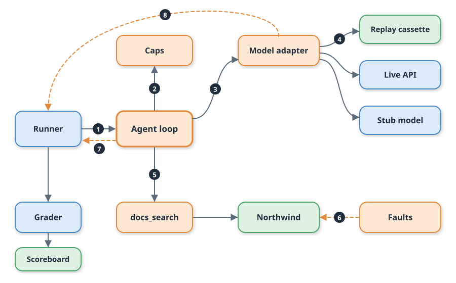

# Day 02 Implementation Guide: Agent Loop, Model Adapter, Replay, and Caps



Numbered badges follow one run: (1) the runner hands a ticket to the agent loop, (2) the caps are checked before every model call, (3) the loop calls the model adapter, (4) the adapter reads a replay cassette by default, (5) a tool request goes to `docs_search`, (6) the fault switchboard can break Northwind, (7) a tool failure ends the run and the runner records an infra error, (8) a provider failure becomes an infra error too. The grader and scoreboard work as on Day 01.

## 1. Prerequisites

Nothing changed today. Python 3.12 and the standard library are enough, and no dependency was added, so there is nothing new to pin in `requirements.txt`. No API key and no network access are needed.

## 2. Start

```bash
unzip lesson-02-relay.zip && cd relay
./start.sh
```

To build on your own Day 01 copy instead, unzip `lesson-01-relay.zip`, then add the new and changed files listed below. If you keep your work in git and tagged Day 01, `git checkout day02-start` gets you the same starting point.

Expected output ends with:

```
[relay] Northwind simulator: http://127.0.0.1:8701
[relay] next: make test-day01   make demo   make score
```

## 3. Build steps

**Step 1: Model interface and adapters** — `src/relay/llm.py` (new)
Defines `Turn`, the `Model` protocol, `AnthropicAdapter`, `ReplayModel`, `RecordModel`, and `make_model`. Why: the loop talks to one interface, so live, replay, and stand-in models are interchangeable.
Check: `make test-day02` includes five adapter and replay tests.

**Step 2: Structured logging** — `src/relay/log.py` (new)
One JSON object per line on stderr, quiet by default. Why: you need to see each model call and tool result when a run misbehaves.
Check: `RELAY_LOG_LEVEL=INFO make demo 2>&1 | head -3` prints JSON lines such as `{"event":"model_call",...}`.

**Step 3: Tool seam and `docs_search`** — `src/relay/tools.py` (new)
A `Tool` has a name, a JSON schema, and a function; `ToolBox` runs calls and raises `ToolError` for anything untrustworthy, including broken JSON. Why: every tool failure takes one path.
Check: `test_tool_fault_ends_the_run_cleanly` passes.

**Step 4: The loop and its caps** — `src/relay/agent.py` (new)
`run_agent` calls the model, runs requested tools, and stops on `done`, `step_cap`, `budget_cap`, `tool_error`, `truncated`, or `unexpected_stop`. Defaults: 6 steps, 8,000 tokens. Why: caps are checked in code, not requested in the prompt.
Check: eight cap tests in `TestCaps` pass.

**Step 5: Stand-in model** — `src/relay/stubmodel.py` (new)
A rules-based model that records the offline fixtures. It writes a keyword query, keeps the doc for the named product, and hands refund requests to a human. Why: replay needs recordings, and recordings need something to record.
Check: `make record PROVIDER=stub` rewrites `fixtures/replay/day02.jsonl` (333 lines), and the next replay run gives the same numbers.

**Step 6: Runner and scoreboard** — `src/relaybench/run.py`, `src/relaybench/scoreboard.py` (changed)
`--agent baseline|loop` selects the agent. Tool errors and provider errors are recorded as infra errors, never as wrong answers. The scoreboard adds `avg_steps` and `capped`. Why: a flaky network must never be blamed on the agent.
Check: `make test-day01` still passes unchanged.

**Step 7: Stand-in Messages API and tests** — `tests/fake_messages_api.py`, `tests/test_day02.py` (new)
A local HTTP server speaks the Messages API shape, so the real adapter code runs offline. Why: it lets the DONE WHEN test cover the live path without a key.
Check: `make test-day02` prints `Ran 17 tests ... OK`.

**Step 8: Targets and demo** — `Makefile`, `scripts/demo.sh`, `.env.example`, `README.md` (changed)
Adds `test-day02`, `AGENT=` on `record`, and a three-run demo. Why: one command should show the before and after.
Check: `make demo` prints three scoreboard rows.

## 4. Build, run, test, verify, demo

| Command | What it does | Expected |
| --- | --- | --- |
| `make build` | Re-seed the world and bench | fingerprint line, then `wrote 250 tasks to data/relay_bench.jsonl` |
| `./start.sh` | Start the simulator | URL printed; running it twice is safe |
| `make test` | Full offline suite | `Ran 30 tests ... OK` |
| `make test-day02` | DONE WHEN check | `Ran 17 tests ... OK` |
| `make verify` | Tests plus health check | `simulator healthy` |
| `make demo` | Baseline, loop, loop under faults | 36.0%, then 66.5%, then 39.0% with 101 errors |
| `make score` | Scoreboard history | one row per run |

Expected `make demo` rows:

```
day01-baseline            36.0%      5.2     0.00000      0%      100%       0
day02-loop                66.5%      8.5     0.00000      0%       30%       0
day02-fault-500x30        39.0%      8.5     0.00000      0%       33%     101
```

Latency varies by machine; the success, esc.prec, and errors columns are exact.

## 5. Fault experiment

```bash
make fault-on FAULT=500 RATE=0.3
PYTHONPATH=src .venv/bin/python src/relaybench/run.py --agent loop --label my-fault-run
make fault-off
make score
```

Expected change: `my-fault-run` shows 39.0% success and 101 errors against 66.5% and 0 for `day02-loop`. Of those, 84 are tickets that never loaded and 17 are runs that stopped at the tool call (`stop` is `tool_error` in `.scoreboard/runs/`). Try `FAULT=malformed`, `429`, and `timeout`; each one ends runs cleanly with no crash and no replay miss. Always run `make fault-off` afterward.

## 6. Live mode (optional)

```bash
export ANTHROPIC_API_KEY=...  RELAY_MODEL=<model id from your provider console>
make record PROVIDER=live
make demo
```

This replaces the stand-in fixtures with your model's real turns. Re-run `make test-day02` afterward: `test_bench_in_replay_beats_the_day01_baseline` pins the stand-in numbers, so update its expected values to your new run. The live path was exercised in tests only against the local Messages API stand-in, never against the real endpoint.

## 7. Troubleshooting

| Symptom | Likely cause | Fix |
| --- | --- | --- |
| `ReplayMiss: no recorded response for this request` | A prompt, tool, or tool result changed, so the hash changed | `make record PROVIDER=stub` (or `live`) |
| Every task shows `ToolError` | Fault switchboard left on | `make fault-on` was run without `make fault-off`; run `make fault-off` |
| `KeyError: 'ANTHROPIC_API_KEY'` or `set RELAY_MODEL` | Live mode without both variables | Export both, or use the default `PROVIDER=replay` |
| `ProviderError: http 429` in live mode | Provider rate limit | Wait and re-run; retry logic is not built yet |
| `capped` is above 0 | A model looped or the budget is too low for your model | Read the `agent_stop` log lines with `RELAY_LOG_LEVEL=INFO`, then raise `RELAY_MAX_STEPS` or `RELAY_MAX_TOKENS` if the work is legitimate |
| Simulator health check fails | Port 8701 in use | `NORTHWIND_PORT=8711 ./start.sh` and export the same variable for `make` |

## 8. Cleanup

```bash
./stop.sh          # stop the simulator
./stop.sh --clean  # also delete generated data and the scoreboard
```
