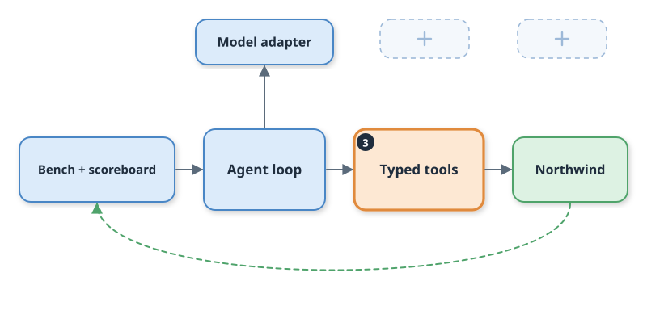
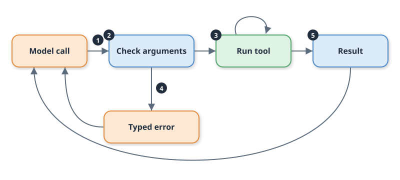
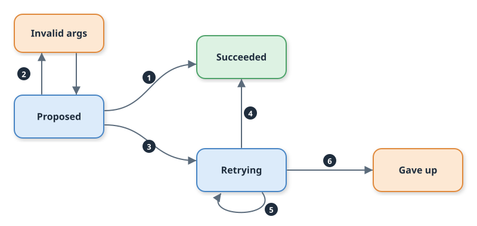

# Day 03: Typed Tools, and Errors the Agent Can Recover From

By the end of today, Relay can refund a duplicate charge, and when the model fumbles a tool call, the tool tells it exactly what to fix and the run carries on.

## Where we are

Day 02 gave Relay a loop with one tool and hard caps. Any tool failure ended the run, and the 60 refund tickets were handed to humans because Relay could not touch billing. Today the orange boxes appear: typed tools.



## The problem

Models make small mistakes with tool arguments. They send `invoiceId` when the tool wants `invoice_id`. They drop a field. They pass `"5000"` where the tool needs `5000`.

On Day 02 that was fatal. Today we corrupt the first tool call in 30% of tickets, the same four mistakes in rotation, and let the Day 02 rule run: any tool error ends the run. Success falls from 96.5% to 80.5%, with 43 runs ending as infra errors. The model was one sentence of feedback away from getting it right.

There is a second gap. With no billing tool, Relay could only hand duplicate-charge tickets to a human: 60 of them in the bench, 0 passed. A refund tool fixes that, but a tool that moves money brings its own question. What happens when the reply to a refund is lost and the call is retried?

## The idea

Think of a bank counter with a form clerk. A bad clerk stamps "REJECTED" on your form. A good clerk circles the box you filled in wrong and writes an example beside it.

A **typed tool** declares each argument's type and shape, and checks them *before* doing anything. A **recoverable error** is a failure the model can fix by changing its next call, so it goes back to the model as a tool result. Relay ships four typed tools: `ticket_get`, `invoice_get`, `refund_issue`, and `docs_search`. Each one declares its arguments once, and the schema the model sees comes from the same declaration the checker uses, so the two cannot drift apart.

A **fatal error** means the world is broken (timeouts, 5xx, broken JSON), so bounded retries run and then the run ends, as on Day 02.

## Field notes

**Write the error for the model, not for a log.** Anthropic's tool-writing guidance says to prompt-engineer error responses so they name a specific, actionable fix instead of an opaque code or traceback. It also says to name parameters unambiguously, `user_id` rather than `user`. Tutorials return `str(exception)`. Relay's errors list every problem at once, with the expected shape, an example, and a did-you-mean hint. ([Anthropic, Writing effective tools for agents](https://www.anthropic.com/research/writing-tools-for-agents))

**Retry in one layer, and only what the world broke.** Amazon's engineers point out that retries multiply across layers: three retries at each of five layers is 243 times the load on the database. They also say client errors should not be retried with the same request. Relay splits the job. The tool layer retries transport failures, three attempts at most. The model loop handles argument mistakes. A bad argument is never retried blindly, and a 500 never reaches the model. ([Amazon Builders' Library, Timeouts, retries, and backoff with jitter](https://builder.aws.com/content/3EumjoZascWd1oZiEgL8ORlv3qE/timeouts-retries-and-backoff-with-jitter))

**A write you retry needs a key the server remembers.** Amazon's same article says APIs with side effects are unsafe to retry unless they are idempotent, meaning repeating them has the effect of doing them once. Stripe's API shows the usual shape: the client generates a key, and the server replays the first result for any repeat of that key. Tutorials wrap `POST` in a retry loop and stop there. Relay derives the key from ticket, invoice, and amount. ([Stripe, Idempotent requests](https://docs.stripe.com/api/idempotent_requests))

## How it works

Five numbered moves carry one tool call.



The numbers follow the order: (1) the model proposes a call, (2) the arguments are checked, (3) the tool runs, with retries on a failing world, (4) a failed check becomes a typed error, (5) a result returns to the model. Notice that both exits return to the model call, and that the argument check happens before any network traffic.

A call ends in one of five states.



Retries use capped exponential backoff: 0.2 s, then 0.4 s, never more than 2 s, and a `Retry-After` header is honoured up to that cap. Notice that Invalid args is the only state that loops back to the model. Retrying loops inside the tool layer and never shows the model a thing, and Gave up is where Day 02's rule still applies.

## Build along

The guide has every command. The shape of the work:

1. Declare each tool's arguments once, and generate the JSON schema from that (`src/relay/tools.py`).
2. Validate before running, and report every problem at once.
3. Add bounded retries and an idempotency key for the refund.
4. Teach the loop to return recoverable errors as error results (`src/relay/agent.py`).
5. Add a bad-argument fault injector (`src/relay/faults.py`), record fixtures, run `make test-day03`.

The loop change is small. The decisive part is which exception goes where:

```python
except RecoverableError as exc:
    if not recover:  # Day 02 behaviour: any tool failure ends the run
        return stop("tool_error", f"{exc.code}: {exc.message}")
    recovered += 1
    results.append({"type": "tool_result", "id": call.id,
                    "content": exc.to_result(), "is_error": True})
    continue
except ToolError as exc:
    return stop("tool_error", str(exc))
```

What the model reads when it sends `invoiceId`:

```json
{"error":"invalid_argument","tool":"invoice_get","retryable":true,
 "message":"invoice_get was not run: 1 problem(s) with the arguments. Fix them and call again.",
 "problems":[{"field":"invoice_id","problem":"missing",
   "expected":"string matching INV-(?:D\\d{4}|\\d{5})","example":"INV-00012",
   "hint":"You sent 'invoiceId'; the field is named 'invoice_id'."}]}
```

The refund is the only tool that moves money, so it carries a key:

```python
def idempotency_key(ticket_id: str, invoice_id: str, amount_cents: int) -> str:
    return hashlib.sha256(f"{ticket_id}|{invoice_id}|{amount_cents}".encode()).hexdigest()[:24]
```

## Break it on purpose

The fault switchboard now has two sides. The simulator breaks the world. The new `bad_args` fault breaks the model's output.

Before: turn the fault on and make every tool error fatal.

```bash
make fault-on FAULT=bad_args RATE=0.3
RELAY_RECOVER=0 make bench AGENT=typed LABEL=fatal
```

You get 80.5% success and 43 infra errors. Now the after:

```bash
make bench AGENT=typed LABEL=recovered
make fault-off
```

You get 96.5% success, 0 infra errors, and 43 recovered tool errors. The same 43 tickets made the same mistakes, and the only change is where the error went.

## Key notes

- **Attack success stays at 0%, and that is not proof.** Today's stand-in model refunds only a verified duplicate on the customer's own ticket and escalates every other mention of a refund. Nothing in the tool layer stops a model that obeys an injected instruction, so a live model needs its own measurement.
- **Escalation precision rose from 30% to 54%.** Of 74 escalations, 40 were real escalations, 27 were attacks, and 7 were CDN doc gaps. The refund tickets no longer escalate.
- **A lost reply is not a failed write.** With the `lost` fault on at rate 1.0, all three attempts fail and the run ends as an infra error, yet exactly one refund exists. The key is why.
- **`bool` is an `int` in Python.** Without an explicit check, `True` passes as `amount_cents`. A test pins it.
- **Fixtures were recorded twice.** Once clean and once with every first call corrupted, so replay covers any fault rate. After a prompt or tool change, run `make record`.

## Success criteria

- [ ] `make test-day03` passes 37 tests, including `test_each_injected_fault_is_recovered_on_a_docs_task_and_a_refund_task` (DONE WHEN).
- [ ] `make test` passes all 67 tests with no API key and no network.
- [ ] After `make demo`, `make score` shows `day03-typed` at 96.5% (from 66.5%) with claimed-but-not-done at 0, and refund tasks at 60/60 (from 0/60).
- [ ] The `day03-argfault30` row shows 0 infra errors and 43 recovered. The `-fatal` row shows 80.5% and 43 infra errors.
- [ ] `./start.sh` and `./stop.sh` each succeed when run twice in a row.

## Production takeaway

Split every tool failure into "the model can fix this" and "the world is broken", and send only the first kind back to the model, with the field, the expected shape, and an example. Give every write a key derived from what makes the request the same.

Next: **Day 04.**
