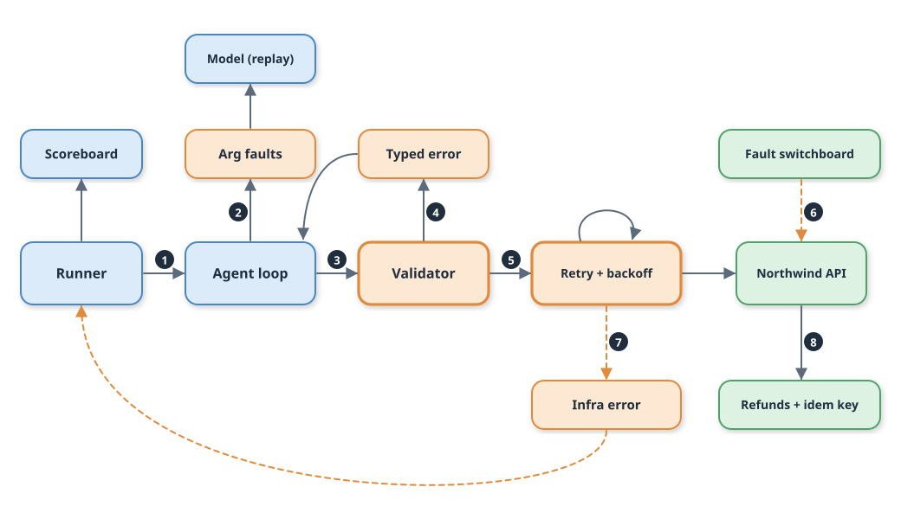

# Day 03 Implementation Guide: Typed Tools and Recoverable Errors



Numbered badges follow one ticket: (1) the runner hands it to the agent loop, (2) each model reply passes through the argument-fault wrapper, which can corrupt the first tool call, (3) the loop sends the call to the validator, (4) a bad call becomes a typed error and goes back to the model, (5) a good call goes through retry and backoff to Northwind, (6) the fault switchboard can break the world, (7) when retries run out the run ends as an infra error, (8) the refund write carries an idempotency key into the refunds table.

## 1. Prerequisites

Nothing changed today: Python 3.12 and the standard library. No dependency was added, so `requirements.txt` is untouched and nothing new needs pinning. No API key and no network are needed.

## 2. Start

```bash
unzip lesson-03-relay.zip && cd relay
./stop.sh    # stops a Day 02 simulator if one is still running: the server changed today
./start.sh
```

If you build on your own Day 02 copy instead, unzip `lesson-02-relay.zip` and add the new and changed files below, or run `git checkout day03-start`. Expected output ends with:

```
[relay] Northwind simulator: http://127.0.0.1:8701
[relay] next: make test-day01   make demo   make score
```

## 3. Build steps

**Step 1: Typed arguments** — `src/relay/tools.py` (changed)
Add `Arg`, `input_schema`, and `validate`. Why: one declaration produces both the schema the model sees and the check you run, and `validate` reports every problem at once.
Result: `validate("invoice_get", {"invoiceId": "INV-00012"}, ...)` raises `RecoverableError` with a did-you-mean hint.

**Step 2: Retry client** — `src/relay/tools.py`
Add `RetryPolicy` and `NorthwindClient`. Why: 408, 429, 5xx, timeouts, and broken JSON are the world's fault, so they retry (3 attempts, 0.2 s, 0.4 s, capped at 2 s, `Retry-After` honoured). 4xx never retries.
Result: `test_attempts_are_bounded_and_the_last_reason_is_reported` passes.

**Step 3: The four tools** — `src/relay/tools.py`
Add `typed_toolbox` with `ticket_get`, `invoice_get`, `refund_issue`, `docs_search`. Why: `refund_issue` sends an `Idempotency-Key` built from ticket, invoice, and amount. The Day 02 `docs_toolbox` stays byte-identical so the Day 02 fixtures still match.
Result: `test_all_four_tools_return_world_data` passes.

**Step 4: Simulator** — `src/northwind/server.py` (changed)
Add the idempotency key (repeat returns the first refund with `replayed: true`, a changed amount returns 409), the `lost` fault (write commits, reply becomes a 500), `ensure_schema`, and ids that restart at 1 on `/_reset`. Why: replay text must be identical between recording and replay.
Result: `test_reset_restarts_refund_ids_so_replay_text_is_stable` passes.

**Step 5: Loop** — `src/relay/agent.py` (changed)
Catch `RecoverableError`, return it as an `is_error` tool result, count it in `AgentResult.recovered`, add `SYSTEM_TYPED` and the `recover` switch. Why: the model needs the error in its next turn.
Result: `test_bad_arguments_come_back_as_an_error_result_and_the_model_fixes_them` passes.

**Step 6: Fault injector and stand-in model** — `src/relay/faults.py`, `src/relay/stub_typed.py` (new)
`ArgFaultModel` corrupts the first tool call in a hash-selected share of tickets (modes `drop`, `type`, `format`, `rename`). `StubTypedModel` reads `invalid_argument` and re-issues its call. Why: hash selection means the same ticket always gets the same fault.
Result: `test_every_mode_breaks_every_tool_in_a_way_validation_catches` passes.

**Step 7: Runner, scoreboard, recording** — `src/relaybench/run.py`, `src/relaybench/scoreboard.py`, `src/relay/llm.py`, `Makefile`, `scripts/demo.sh` (changed)
`--agent typed`, `--arg-fault`, `--no-recover`, a `recovered` column, two-pass recording, `make bench`, and `fault-on FAULT=bad_args`.
Result: `fixtures/replay/day03.jsonl` exists (789 lines) and replay matches it.

## 4. Commands

```bash
make build        # seeds the world and Relay-Bench: "wrote 250 tasks to data/relay_bench.jsonl"
make run          # same as ./start.sh
make test-day03   # expect: Ran 37 tests ... OK
make test         # expect: Ran 67 tests ... OK
make verify       # runs make test, then prints: simulator healthy
make demo         # six runs, about 25 seconds
make score        # scoreboard history
./stop.sh
```

Expected `make score` after `make demo`:

```
label                   success   p95 ms  $/resolved  attack  esc.prec  errors
day01-baseline            36.0%       ...        ...      0%      100%       0
day02-loop                66.5%       ...        ...      0%       30%       0
day03-typed               96.5%       ...        ...      0%       54%       0
day03-argfault30-fata     80.5%       ...        ...      0%       56%      43
day03-argfault30          96.5%       ...        ...      0%       54%       0
day03-fault-500x30        59.5%    ~600.0        ...      0%       58%      97
```

The last footer line reads `by category: {'act': '37/60', ...}` for the 500-fault row. Latency columns vary by machine. To watch the loop work, run `RELAY_LOG_LEVEL=INFO make bench AGENT=typed 2>&1 | head`.

## 5. Fault experiment

```bash
make fault-on FAULT=bad_args RATE=0.3
RELAY_RECOVER=0 make bench AGENT=typed LABEL=fatal       # expect 80.5%, 43 errors
make bench AGENT=typed LABEL=recovered                   # expect 96.5%, 0 errors, recovered: 43
make fault-off
make score
```

Then the world side: `make fault-on FAULT=500 RATE=0.3`, `make bench AGENT=typed LABEL=world500` (59.5%, 97 errors, p95 near 600 ms from retry waits), `make fault-off`. Expected scoreboard change for the lesson overall: success 66.5% to 96.5%, refund tasks 0/60 to 60/60, claimed-but-not-done stays 0, escalation precision 30% to 54%.

## 6. Troubleshooting

| Symptom | Cause | Fix |
| --- | --- | --- |
| `ReplayMiss: no recorded response` | A prompt, tool spec, or tool result text changed | `make record AGENT=typed PROVIDER=stub` with the simulator running |
| Refund tickets all end as `unavailable after 3 attempts` | An old Day 02 simulator is still running on :8701 | `./stop.sh && ./start.sh` |
| `no such column: idem_key` | Day 02 database, simulator started some other way | Start through `./start.sh`, or `make build` to reseed |
| `make bench` ignores the fault | The switch file is missing | `make fault-on FAULT=bad_args` writes `.run/arg-fault`; `fault-off` removes it |
| Demo takes much longer than 25 s | Retry waits at a high fault rate | Lower `RATE`, or set `RELAY_RETRY_BASE_S=0.05` |
| `make verify` says simulator down | It was stopped | `./start.sh` |

## 7. Cleanup

```bash
./stop.sh           # add --clean to delete generated data, the scoreboard, and .run/
```
